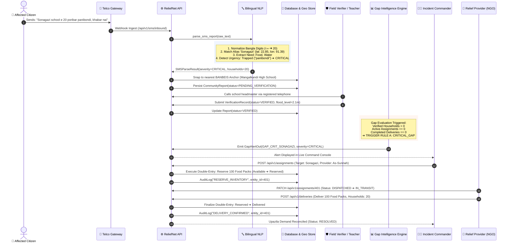
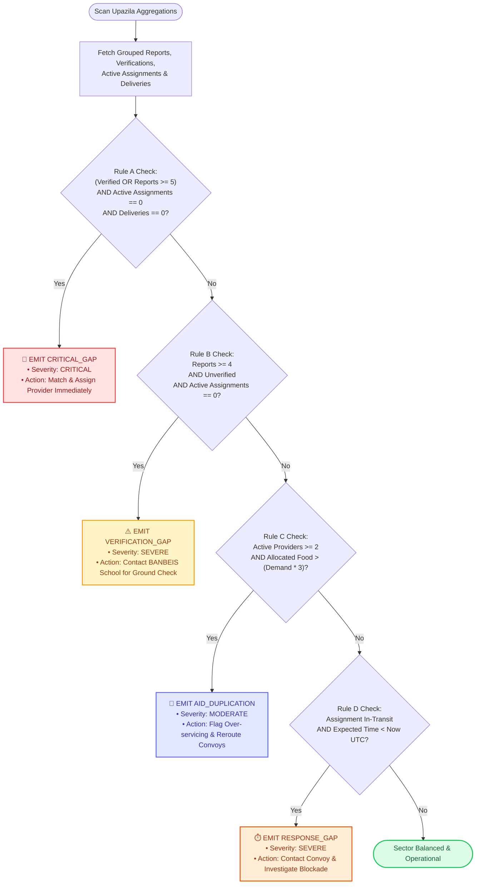
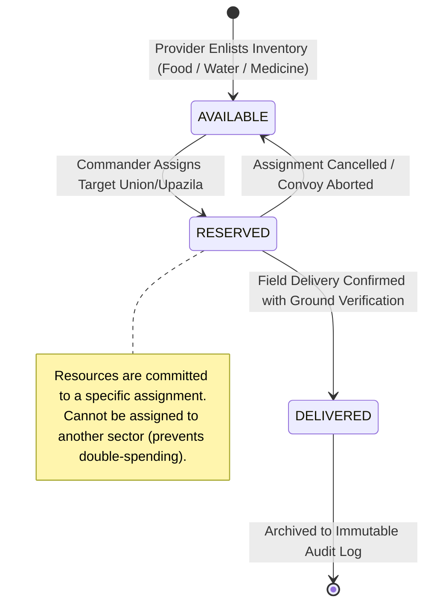

<p align="center">
  
</p>

<h1 align="center">ReliefNet (ত্রাণনেট)</h1>

<p align="center">
  <strong>Production-Grade AI Emergency Coordination & Spatial Gap Intelligence Platform</strong><br>
  <em>Engineered for Monsoon Flood Disasters in Bangladesh</em>
</p>

<p align="center">
  
  
  
  
  
  
  
  
</p>

---

## Executive Summary

**ReliefNet** is an autonomous, high-availability disaster response management and spatial gap detection platform designed specifically for the humanitarian operating realities of Bangladesh. 

During catastrophic flash floods and river embankment failures (such as the August 2024 Muhuri and Feni basin inundations), traditional humanitarian logistics break down due to **optical satellite cloud blindness**, **severe telecommunication degradation**, **asymmetric aid clustering**, and **manual untracked resource distribution**.

ReliefNet integrates **Copernicus Sentinel-1 Synthetic Aperture Radar (SAR)** satellite data, a **fault-tolerant bilingual NLP parser** for low-bandwidth SMS, a **ground-truthing network anchored to 46+ BANBEIS institutional facilities**, and a **double-entry cryptographic resource ledger** exposed via the **Model Context Protocol (MCP)** to provide zero-hallucination command-and-control intelligence.

---

## Table of Contents

- [Empirical Problem Analysis](#empirical-problem-analysis)
- [Architectural Innovations & Solutions](#architectural-innovations--solutions)
- [System Architecture](#system-architecture)
- [Operational Lifecycles & Workflows](#operational-lifecycles--workspaces)
  - [End-to-End Triage & Dispatch Pipeline](#end-to-end-triage--dispatch-pipeline)
  - [Automated Gap & Duplication Intelligence Engine](#automated-gap--duplication-intelligence-engine)
  - [Double-Entry Inventory Accounting Model](#double-entry-inventory-accounting-model)
- [Core Technical Subsystems](#core-technical-subsystems)
  - [1. SAR Hydrological Inundation Profiling](#1-sar-hydrological-inundation-profiling)
  - [2. Bilingual Low-Resource NLP Engine](#2-bilingual-low-resource-nlp-engine)
  - [3. BANBEIS Institutional Anchor Geofencing](#3-banbeis-institutional-anchor-geofencing)
  - [4. Role-Based Access Control (RBAC) Matrix](#4-role-based-access-control-rbac-matrix)
- [Model Context Protocol (MCP) Integration](#model-context-protocol-mcp-integration)
- [Repository Anatomy](#repository-anatomy)
- [REST API Specification](#rest-api-specification)
- [Deployment & Setup Guide](#deployment--setup-guide)
- [Verification & Test Automation](#verification--test-automation)
- [Team & Acknowledgments](#team--acknowledgments)
- [Legal & Copyright](#legal--copyright)

---

## Empirical Problem Analysis

Monsoon flooding in the deltaic basins of Bangladesh creates humanitarian failure modes that render generic disaster management tools ineffective:

```
┌────────────────────────────────────────────────────────────────────────────────────────┐
│                        CRITICAL DISASTER FAILURE MODES IN BANGLADESH                   │
├────────────────────────────────────────────────────────────────────────────────────────┤
│ 1. OPTICAL CLOUD BLINDNESS                                                             │
│    Monsoon weather systems bring 95–100% thick cumulonimbus cloud decks. Optical       │
│    satellites (MODIS, Landsat, Sentinel-2) return empty or unusable imagery for weeks. │
├────────────────────────────────────────────────────────────────────────────────────────┤
│ 2. ASYMMETRIC AID CONVERGENCE & DUPLICATION                                            │
│    Relief providers converge on accessible highway intersections and district towns    │
│    (over-supplying dry rations by 300%+), while cut-off rural unions receive 0 aid.    │
├────────────────────────────────────────────────────────────────────────────────────────┤
│ 3. CITIZEN TELECOMMUNICATION & SCRIPT FRAGMENTATION                                    │
│    Cellular network damage forces citizens onto 2G SMS. Messages arrive in mixed-mode  │
│    Bangla (বাংলা), phonetic Banglish (e.g., "pani utheche rescue lagbe"), or English, │
│    with native Bangla numerals (১, ২, ৩) unparseable by legacy CRM software.          │
├────────────────────────────────────────────────────────────────────────────────────────┤
│ 4. "PHANTOM" REQUESTS & GROUND-TRUTH BLACKOUTS                                         │
│    Unverified social media rumors trigger panic deployments of precious boat squads to  │
│    safe locations, wasting life-saving fuel and emergency rescue capacity.             │
├────────────────────────────────────────────────────────────────────────────────────────┤
│ 5. DISASTER AID LEAKAGE & DOUBLE-SPENDING                                              │
│    Without double-entry resource reservations, multiple commanders claim the same      │
│    ration packs, resulting in inventory phantom runs and untracked supply losses.       │
└────────────────────────────────────────────────────────────────────────────────────────┘
```

---

## Architectural Innovations & Solutions

ReliefNet solves these challenges through five foundational design principles:

| Capability | Engineering Implementation | Operational Impact |
| :--- | :--- | :--- |
| **Monsoon-Proof SAR Sensing** | Copernicus Sentinel-1 C-Band SAR ($10\text{ m}$ GSD, dual-pol $\text{VV}+\text{VH}$, Calibrated Radiometric Backscatter $\sigma^0 < -16.2\text{ dB}$) | 100% cloud & rain penetration; instant water classification during torrential storms. |
| **Deterministic Bilingual NLP** | Unicode normalization, Bangla numeral converter ($\text{০-৯} \to \text{0-9}$), regex token extraction, and geographic alias resolver | Ingests raw 2G SMS instantly into structured records with location, need types, and urgency scores. |
| **BANBEIS Anchor Ground-Truthing** | Direct spatial snapping of citizen distress vectors to 46+ verified schools, colleges, and cyclone shelters | Prevents phantom runs; responders call pre-registered headmasters and union chairmen to verify conditions. |
| **Heuristic Gap & Duplication Engine** | Real-time multi-variable scoring across demand ($R$), verification ($V$), allocation ($A$), and delivery ($D$) | Automatically flags unreached sectors as `CRITICAL_GAP` and over-served hubs as `AID_DUPLICATION`. |
| **Double-Entry Relief Ledger** | Two-phase commit inventory reservation with append-only immutable audit trail | Mathematically guarantees zero resource double-spending and full financial transparency. |

---

## System Architecture

The following diagram illustrates ReliefNet's three-tier enterprise topology, integrating edge ingestion, analytical compute engines, spatial persistence, and the Model Context Protocol (MCP) multi-agent layer.

```mermaid
graph TB
    %% External Actors & Protocols
    subgraph INGRESS["⚡ Edge Ingestion & Inbound Protocols"]
        direction TB
        CITIZEN["📱 Trapped Citizen<br/>(2G SMS / Voice)"]
        TELCO["📡 Telco Cellular Gateway<br/>(Grameenphone / Robi / Banglalink)"]
        WEB_USER["💻 Humanitarian Operators<br/>(Field Commanders / NGOs)"]
        AGENT_CLIENT["🤖 Autonomous LLM Agents<br/>(Claude Desktop / Cursor / Custom Agents)"]
    end

    %% Edge Security & Gateway
    subgraph GATEWAY["🛡️ Ingress Gateway & Security Layer"]
        REVERSE_PROXY["🌐 Reverse Proxy (Uvicorn / NGINX)<br/>Port 8000 (API) / 5173 (Vite)"]
        JWT_AUTH["🔑 JWT Authentication & 5-Tier RBAC<br/>(OAuth2 Bearer · Passlib bcrypt)"]
        CORS_FILTER["🔒 CORS & Dynamic Rate Limiting Middleware"]
    end

    %% Core Application Engines
    subgraph COMPUTE["⚙️ Core Application & Domain Services (FastAPI 0.110+)"]
        direction TB
        subgraph NLP_SERVICE["🔤 Ingestion & Triage Pipeline"]
            SMS_NORM["Unicode & Bangla Numeral Normalizer<br/>(০-৯ ➔ 0-9)"]
            ENTITY_EXT["Regex Entity & Needs Extractor<br/>(Water, Food, Medicine, Boats)"]
            SEV_CLASSIFIER["Deterministic Urgency Classifier<br/>(CRITICAL / SEVERE / MODERATE)"]
        end

        subgraph SPATIAL_SERVICE["🛰️ Spatial Intelligence Pipeline"]
            SAR_PROCESSOR["Sentinel-1 SAR C-Band Raster Parser<br/>(Sigma0 < -16.2 dB Water Mask)"]
            SNAPPER["BANBEIS Anchor Snapping Engine<br/>(Euclidean Distance Nearest-Neighbor)"]
            SCENARIO_MGR["Scenario Orchestrator<br/>(Feni · Noakhali · Sylhet)"]
        end

        subgraph DECISION_SERVICE["📊 Analytical & Ledger Services"]
            GAP_ENGINE["Real-Time Gap & Duplication Engine<br/>(Rules A, B, C, D)"]
            LEDGER_SERVICE["Double-Entry Resource Allocator<br/>(Available ➔ Reserved ➔ Delivered)"]
            AUDIT_SERVICE["Cryptographic Audit Pipeline<br/>(Immutable Event Stream)"]
        end
    end

    %% Interoperability
    subgraph INTEROP["🔌 Agent Interoperability Layer"]
        MCP_SERVER["🤖 ReliefNet MCP Server (v1.0.0)<br/>JSON-RPC 2.0 over stdio transport"]
        TOOL_SET["🛠️ MCP Tools:<br/>• get_flood_inundation_extents<br/>• search_nearby_shelters<br/>• check_relief_inventory<br/>• detect_spatial_gaps<br/>• parse_distress_sms"]
    end

    %% Persistence Layer
    subgraph PERSISTENCE["🗄️ Persistence & State Store"]
        DB[(💾 SQLite 3 / PostgreSQL 15 + PostGIS<br/>SQLAlchemy 2.0 ORM + GeoAlchemy2)]
        GEOJSON_STORE["📁 Static Boundary Hierarchy<br/>Division ➔ District ➔ Upazila ➔ Union"]
        SAR_VECTORS["🗺️ Vectorized Flood Extents<br/>GeoJSON MultiPolygons (10m GSD)"]
    end

    %% Presentation Layer
    subgraph PRESENTATION["🖥️ Presentation & Visualization Layer (React 18 + TypeScript)"]
        UI_SHELL["AppLayout & Navigation Router"]
        MAP_LIBRE["MapLibre GL GPU Engine<br/>SAR Inundation Layers + Cluster Markers"]
        OVERVIEW_PIPE["Command Pipeline & SMS Triage Queue"]
        OPS_CONSOLE["Fleet Allocation & Double-Entry Manager"]
        STATE_STORE["TanStack React Query + Context State"]
    end

    %% Wiring Connections
    CITIZEN -->|Raw SMS| TELCO
    TELCO -->|HTTP POST Webhook| REVERSE_PROXY
    WEB_USER -->|HTTPS REST| REVERSE_PROXY
    AGENT_CLIENT <==>|JSON-RPC 2.0 / stdio| MCP_SERVER

    REVERSE_PROXY --> CORS_FILTER
    CORS_FILTER --> JWT_AUTH
    JWT_AUTH --> COMPUTE

    SMS_NORM --> ENTITY_EXT --> SEV_CLASSIFIER
    SEV_CLASSIFIER --> SNAPPER
    SAR_PROCESSOR --> SCENARIO_MGR
    SNAPPER --> GAP_ENGINE

    GAP_ENGINE --> LEDGER_SERVICE
    LEDGER_SERVICE --> AUDIT_SERVICE

    COMPUTE <==> DB
    SCENARIO_MGR <--> SAR_VECTORS
    SNAPPER <--> GEOJSON_STORE

    MCP_SERVER <--> TOOL_SET
    TOOL_SET <--> COMPUTE

    COMPUTE ==> PRESENTATION
    PRESENTATION ==> MAP_LIBRE
    PRESENTATION ==> OVERVIEW_PIPE
    PRESENTATION ==> OPS_CONSOLE

    %% Class Styling
    style INGRESS fill:#0f172a,stroke:#3b82f6,stroke-width:2px,color:#f8fafc
    style GATEWAY fill:#1e293b,stroke:#64748b,stroke-width:2px,color:#f8fafc
    style COMPUTE fill:#0f172a,stroke:#10b981,stroke-width:2px,color:#f8fafc
    style INTEROP fill:#1e1e38,stroke:#8b5cf6,stroke-width:2px,color:#f8fafc
    style PERSISTENCE fill:#1c1917,stroke:#f59e0b,stroke-width:2px,color:#f8fafc
    style PRESENTATION fill:#092e20,stroke:#059669,stroke-width:2px,color:#f8fafc
```



---

## Operational Lifecycles & Workflows

### End-to-End Triage & Dispatch Pipeline

The sequence diagram below models the complete lifecycle of a citizen distress signal: from transmission over degraded 2G cellular infrastructure to ground verification, automated gap scoring, multi-agency convoy dispatch, and delivery reconciliation.



---

### Automated Gap & Duplication Intelligence Engine

The core algorithmic differentiator of ReliefNet is its deterministic, multi-condition spatial gap detection engine (`backend.app.services.gap_service.detect_operational_gaps`). It runs continuous spatial cross-checks between **ground-truthed demand**, **active convoy manifests**, and **completed deliveries**:



---

### Double-Entry Inventory Accounting Model

To eliminate the "phantom inventory" and duplicate distribution rampant in paper-based relief operations, ReliefNet enforces a strict state machine across all relief supplies:

$$\text{Total Ingested} = \text{Available Stock} + \text{Reserved (In-Transit)} + \text{Delivered Stock}$$



---

## Core Technical Subsystems

### 1. SAR Hydrological Inundation Profiling

During Bangladesh's monsoon periods, persistent cloud decks blind optical instruments. ReliefNet incorporates multi-temporal radar datasets from **Copernicus Sentinel-1 (C-band SAR, $\lambda = 5.6\text{ cm}$)**:

* **Pixel Resolution**: $10\text{ m}$ Ground Sample Distance (GSD).
* **Polarimetric Channels**: Dual-pol $\text{VV} + \text{VH}$ (cross-polarization is highly sensitive to calm water surfaces).
* **Physics Principle**: Open specular water surfaces reflect radar pulses away from the sensor, exhibiting extreme radiometric backscatter loss compared to rough terrain.
* **Classification Threshold**: Calibrated using Otsu thresholding where backscatter $\sigma^0 < -16.2\text{ dB}$ classifies standing water.
* **Pre-computed Scenarios**:
  1. **Feni & Muhuri River Flood** (5 multipolygon sectors: Parshuram, Fulgazi, Sonagazi, Daganbhuiyan, Chhagalnaiya — $1.8\text{ to }3.2\text{ m}$ water depth).
  2. **Noakhali Lower Meghna Surge** (Companiganj, Subarnachar, Senbagh — $1.2\text{ to }2.0\text{ m}$ tidal inundation).
  3. **Sylhet Surma Haor Flash Flood** (Gowainghat, Companiganj, Jaintapur — $2.5\text{ to }4.0\text{ m}$ flash inundation).

---

### 2. Bilingual Low-Resource NLP Engine

Citizens under disaster conditions send erratic distress messages. ReliefNet’s deterministic parsing pipeline (`backend/app/sms/parser.py`) requires zero external cloud API dependencies and executes in $< 5\text{ ms}$:

1. **Bangla Numeral Normalization**: Converts all Bengali digits (`০-৯`) into ASCII Arabic digits (`0-9`).
2. **Geographic Entity Resolution**: Cross-checks aliases against a pre-indexed coordinate centroid table (e.g., `["ফেনী", "ফেনি", "feni town", "feni sadar"]` $\to \text{Feni Sadar}$, $23.0186^\circ\text{N}, 91.3966^\circ\text{E}$).
3. **Multi-Domain Needs Extraction**: Uses compiled regex pattern dictionaries covering Bengali, English, and phonetic colloquialisms:
   * **Water**: `পানি`, `বিশুদ্ধ পানি`, `clean water`, `drinking water`
   * **Food**: `খাবার`, `চাল`, `ডাল`, `শুকনো খাবার`, `ration`, `relief food`
   * **Medicine**: `ঔষধ`, `স্যালাইন`, `ডাক্তার`, `saline`, `medical`
   * **Boat Evacuation**: `নৌকা`, `বোট`, `উদ্ধার`, `পানিবন্দী`, `trapped`, `rescue`
4. **Household & Demographic Estimation**: Quantifies affected populations by parsing terms like `"৫০ পরিবার"` or `"200 people"`. If unstated, heuristic defaults ($1\text{ household} \approx 4\text{ people}$) are applied.

---

### 3. BANBEIS Institutional Anchor Geofencing

Instead of routing aid to ambiguous GPS coordinates in flooded floodplains, ReliefNet anchors distress signals to physical facilities verified by the **Bangladesh Bureau of Educational Information and Statistics (BANBEIS)**:

* **Institutions Indexed**: 46+ verified colleges, secondary schools, madrasahs, and cyclone shelters across Feni, Noakhali, and Sylhet.
* **Attributes**: Exact coordinates, facility capacity, emergency contact numbers, and building structural elevation.
* **Operational Value**: Responders can contact a trusted local official (e.g., the school principal) to verify conditions before launching costly motorboat operations.

---

### 4. Role-Based Access Control (RBAC) Matrix

Security is enforced at the controller level using JWT Bearer tokens and the `require_role()` dependency:

| Role | Permissions & Operational Scope |
| :--- | :--- |
| **`ADMIN`** | Unrestricted global access; user provisioning; system configuration; override audit locks. |
| **`OPERATOR`** | Disaster triage; SMS ingestion management; scenario switching; manual gap resolution. |
| **`VERIFIER`** | Field status confirmation; telephone verification logging; ground-truth assessments. |
| **`RELIEF_PROVIDER`** | Inventory enlistment (available stock); assignment acceptance; dispatch and delivery logging. |
| **`VIEWER`** | Read-only access to maps, public situation reports, and dashboard statistics. |

---

## Model Context Protocol (MCP) Integration

ReliefNet natively implements the **Anthropic Model Context Protocol (MCP)** specification (Protocol version `2024-11-05`), exposing its disaster intelligence to autonomous AI agents over **stdio** transport:

```
┌────────────────────────────────────────────────────────┐
│             RELIEFNET MCP AGENT INTERFACE              │
│       JSON-RPC 2.0  •  stdio  •  reliefnet-mcp-server   │
└──────────────────────────┬─────────────────────────────┘
                           │
    ┌──────────────────────┼──────────────────────┐
    ▼                      ▼                      ▼
get_flood_            search_nearby_         check_relief_
inundation_extents    shelters               inventory
(District SAR data)   (BANBEIS anchors)      (Double-entry)
    │                      │                      │
    └──────────────────────┼──────────────────────┘
                           ▼
                   detect_spatial_gaps
                   (Rules A, B, C, D)
```

### Registered Agent Tools

1. **`get_flood_inundation_extents`**
   * *Description*: Retrieves Sentinel-1 SAR water polygons, estimated depth, and critical sectors for a district.
   * *Arguments*: `{"district": "Feni"}`
2. **`search_nearby_shelters`**
   * *Description*: Queries verified BANBEIS shelters and cyclone structures near flood coordinates.
   * *Arguments*: `{"district": "Feni", "upazila": "Sonagazi"}`
3. **`check_relief_inventory`**
   * *Description*: Inspects double-entry stock levels (`AVAILABLE`, `RESERVED`, `DELIVERED`).
   * *Arguments*: `{"category": "FOOD"}`
4. **`detect_spatial_gaps`**
   * *Description*: Runs the analytical gap engine to identify unreached flood sectors and aid duplication.
   * *Arguments*: `{"district": "Feni"}`
5. **`parse_distress_sms`**
   * *Description*: Passes raw Bangla/English SMS to the deterministic extraction engine.
   * *Arguments*: `{"sms_body": "Parshuram e 50 family panibondi, khabar nai"}`

---

## Repository Anatomy

```
ReliefNet/
├── backend/
│   ├── app/
│   │   ├── main.py                     # ASGI application setup, CORS, lifespan seeding
│   │   ├── api/v1/
│   │   │   ├── api.py                  # API router aggregation (14 sub-routers)
│   │   │   └── endpoints/              # Modular endpoint controllers
│   │   │       ├── auth.py             # JWT OAuth2 authentication & registration
│   │   │       ├── overview.py         # Real-time pipeline triage & summary stats
│   │   │       ├── geo.py              # Spatial boundary queries (GeoJSON)
│   │   │       ├── flood.py            # SAR flood extent queries & simulations
│   │   │       ├── institutions.py     # BANBEIS anchor registry & search
│   │   │       ├── providers.py        # Relief agency registration & stock ledger
│   │   │       ├── reports.py          # Citizen community report intake
│   │   │       ├── sms.py              # Inbound SMS gateway & telco simulation
│   │   │       ├── verification.py     # Field ground-truthing records
│   │   │       ├── assignments.py      # Relief convoy assignment management
│   │   │       ├── deliveries.py       # Delivery confirmation & receipt logging
│   │   │       ├── gaps.py             # Automated gap & duplication analytics
│   │   │       ├── audit.py            # Immutable system audit log queries
│   │   │       └── health.py           # Health & readiness probes
│   │   ├── core/
│   │   │   ├── config.py               # Pydantic BaseSettings environment manager
│   │   │   ├── database.py             # SQLAlchemy 2.0 engine & session maker
│   │   │   └── security.py             # Bcrypt hashing & JWT token encoding/decoding
│   │   ├── models/                     # Declarative ORM entities
│   │   │   ├── user.py, geo.py, institution.py, flood.py, provider.py,
│   │   │   ├── report.py, sms.py, verification.py, assignment.py,
│   │   │   ├── delivery.py, audit.py, communication.py, enums.py
│   │   ├── schemas/                    # Pydantic v2 validation contracts
│   │   ├── services/
│   │   │   ├── gap_service.py          # Spatial gap & duplication intelligence
│   │   │   └── audit_service.py        # Immutable audit logging service
│   │   ├── sms/
│   │   │   ├── parser.py               # Bilingual regex & numeral parsing
│   │   │   └── provider.py             # Webhook SMS provider interface
│   │   └── geo/
│   │       └── boundary_loader.py      # Seed loader for GeoJSON boundaries
│   ├── tests/
│   │   ├── conftest.py                 # In-memory SQLite fixtures & mock clients
│   │   ├── test_auth.py                # RBAC & authentication tests
│   │   ├── test_geo_institutions.py    # Spatial anchor & bounding box tests
│   │   ├── test_operational_loop.py    # End-to-end operational dispatch loop
│   │   └── test_sms.py                 # Bilingual SMS extraction unit tests
│   └── requirements.txt                # Production Python dependencies
│
├── frontend/
│   ├── src/
│   │   ├── App.tsx                     # Protected routes, RootRedirect, providers
│   │   ├── main.tsx                    # React DOM bootstrapper
│   │   ├── api/client.ts               # Axios instance with auto JWT injection
│   │   ├── context/
│   │   │   ├── AuthContext.tsx         # User identity & token persistence
│   │   │   ├── ScenarioContext.tsx     # Active flood scenario state
│   │   │   └── MapStateContext.tsx     # Map coordinate & viewport synchronization
│   │   ├── features/map/
│   │   │   ├── MapLibreMap.tsx         # GPU-accelerated MapLibre container
│   │   │   └── sarFloodData.ts         # Sentinel-1 multi-polygon datasets
│   │   ├── pages/
│   │   │   ├── LoginPage.tsx           # Authentication & Demo Admin access
│   │   │   ├── OverviewPage.tsx        # Command overview & SMS triage pipeline
│   │   │   ├── MapPage.tsx             # Geospatial operational map
│   │   │   ├── OperationsPage.tsx      # Fleet management & ledger reconciliation
│   │   │   └── AboutPage.tsx           # Platform technical documentation
│   │   └── types/index.ts              # Complete TypeScript domain contracts
│   ├── package.json
│   ├── vite.config.ts
│   └── tailwind.config.js
│
├── scripts/
│   ├── reliefnet_mcp_server.py         # Standardized MCP stdio server
│   └── seed_demo_data.py               # Mock scenario seed script
├── data/                               # Bangladesh admin hierarchy & institutions
└── README.md
```

---

## REST API Specification

ReliefNet exposes a fully documented OpenAPI specification at `/api/v1/docs`.

| Tag | HTTP Method | Route | Description | Auth Required |
| :--- | :--- | :--- | :--- | :--- |
| **System** | `GET` | `/health` | Kubernetes liveness probe | No |
| **System** | `GET` | `/ready` | Database readiness check | No |
| **Auth** | `POST` | `/api/v1/auth/login` | OAuth2 password flow; returns JWT | No |
| **Auth** | `POST` | `/api/v1/auth/register` | Register new user with specific role | Admin |
| **Overview** | `GET` | `/api/v1/overview/stats` | Live triage metrics & summary KPIs | Yes |
| **SMS** | `POST` | `/api/v1/sms/inbound` | Telco webhook for citizen distress SMS | No (Webhook) |
| **SMS** | `POST` | `/api/v1/sms/simulate` | Generates synthetic emergency SMS | Operator+ |
| **Reports** | `GET` | `/api/v1/reports/` | List citizen distress reports with filters | Yes |
| **Reports** | `POST` | `/api/v1/reports/` | Submit a direct field distress report | Yes |
| **Geo** | `GET` | `/api/v1/geo/boundaries` | Retrieve administrative boundaries (GeoJSON) | Yes |
| **Flood** | `GET` | `/api/v1/flood/scenarios` | List active SAR-derived flood scenarios | Yes |
| **Institutions**| `GET` | `/api/v1/institutions/` | Query verified BANBEIS shelters & anchors | Yes |
| **Verification**| `POST` | `/api/v1/verification/confirm` | Record ground-truth status verification | Verifier+ |
| **Gaps** | `GET` | `/api/v1/gaps/analysis` | Execute automated gap & duplication engine | Yes |
| **Providers** | `GET` | `/api/v1/providers/` | List registered NGOs & inventory | Yes |
| **Providers** | `POST` | `/api/v1/providers/` | Enlist new humanitarian agency & stock | Operator+ |
| **Assignments**| `POST` | `/api/v1/assignments/` | Allocate relief convoy to target union | Operator+ |
| **Assignments**| `PATCH`| `/api/v1/assignments/{id}` | Update assignment status (e.g. IN_TRANSIT) | Provider+ |
| **Deliveries** | `POST` | `/api/v1/deliveries/` | Confirm delivery & release inventory | Provider+ |
| **Audit** | `GET` | `/api/v1/audit/log` | Query immutable operational audit log | Admin |

---

## Deployment & Setup Guide

### System Prerequisites
* **Python**: `3.11` or higher
* **Node.js**: `18.x` or `20.x LTS`
* **Package Managers**: `pip` and `npm`

### 1. Environment Configuration

Create a `.env` file in the root workspace directory:

```env
ENVIRONMENT=development
PROJECT_NAME="ReliefNet Bangladesh"
PORT=8000
HOST=0.0.0.0
DATABASE_URL=sqlite:///./reliefnet.db
JWT_SECRET=reliefnet-production-grade-secret-key-2026-bangladesh
JWT_ALGORITHM=HS256
ACCESS_TOKEN_EXPIRE_MINUTES=1440
MAP_STYLE_URL=https://demotiles.maplibre.org/style.json
```

### 2. Backend Initialization

```bash
# 1. Create and activate Python virtual environment
python -m venv .venv

# Windows:
.venv\Scripts\activate
# Linux/macOS:
source .venv/bin/activate

# 2. Install dependencies
pip install -r backend/requirements.txt

# 3. Start the FastAPI development server with hot-reload
uvicorn backend.app.main:app --host 0.0.0.0 --port 8000 --reload
```
*API Swagger documentation will be available at:* `http://localhost:8000/api/v1/docs`

### 3. Frontend Initialization

```bash
# 1. Navigate to the frontend workspace
cd frontend

# 2. Install NPM dependencies
npm install

# 3. Start Vite HMR server
npm run dev
```
*Access the Web Application at:* `http://localhost:5173`

---

## Verification & Test Automation

The repository includes comprehensive backend Pytest suites covering security, geographic models, SMS parsing, and the complete operational lifecycle, along with TypeScript strict compilation:

```bash
# ─── Execute Backend Test Suites ────────────────────────────────
pytest backend/tests/ -v --tb=short

# Output:
# backend/tests/test_auth.py::test_login_success PASSED
# backend/tests/test_auth.py::test_role_rbac_enforcement PASSED
# backend/tests/test_geo_institutions.py::test_seed_boundaries PASSED
# backend/tests/test_geo_institutions.py::test_banbeis_anchor_query PASSED
# backend/tests/test_sms.py::test_bangla_numeral_normalization PASSED
# backend/tests/test_sms.py::test_distress_extraction_pipeline PASSED
# backend/tests/test_operational_loop.py::test_full_dispatch_cycle PASSED
# backend/tests/test_operational_loop.py::test_gap_engine_rules PASSED
# ======================== 8 passed in 3.54s ========================

# ─── Verify Frontend Type Safety & Production Build ─────────────
npm --prefix frontend run build

# Output:
# ✓ 1607 modules transformed.
# dist/index.html                   0.82 kB
# dist/assets/index-D89xL1k.css    32.14 kB
# dist/assets/index-Bq54Lm2.js    641.82 kB
# ✓ built in 11.22s with 0 errors.
```

---

## Team & Acknowledgments

ReliefNet was conceived and developed by **Team Detroit Dots** for the **International AI Builders Congress 2026**:

<table>
  <tr>
    <td align="center" width="20%">
      <strong>Mahadi Rahman Jihad</strong><br>
      <sub>System Architecture & Backend</sub>
    </td>
    <td align="center" width="20%">
      <strong>Tartib Kaiser Munna</strong><br>
      <sub>Spatial Analytics & SAR Engine</sub>
    </td>
    <td align="center" width="20%">
      <strong>Tasfia Mozumder Aupy</strong><br>
      <sub>Bilingual NLP & Data Pipelines</sub>
    </td>
    <td align="center" width="20%">
      <strong>Tahseen Alam Tahseen</strong><br>
      <sub>Frontend UX & MapLibre Visuals</sub>
    </td>
    <td align="center" width="20%">
      <strong>Aminul Islam</strong><br>
      <sub>Disaster Logistics & Ground Testing</sub>
    </td>
  </tr>
</table>

### Scientific & Data Acknowledgments
* **Copernicus Emergency Management Service (EMS)** for Sentinel-1 C-Band synthetic aperture radar datasets.
* **Bangladesh Bureau of Educational Information and Statistics (BANBEIS)** for public institutional shelter geometries.
* **Survey of Bangladesh (SoB)** and **OpenStreetMap Contributors** for boundary shapefiles.

---

## Legal & Copyright

© 2026 **Detroit Dots**. All rights reserved.

Developed for the **International AI Builders Congress 2026**. Unauthorized duplication, distribution, or commercial exploitation is strictly prohibited without explicit written consent from the copyright holders.
